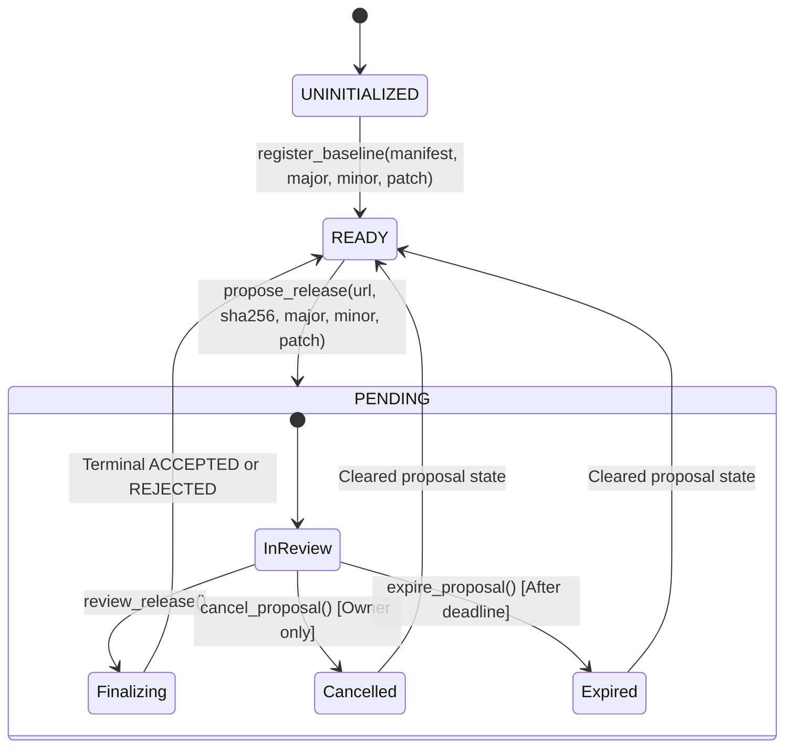

# ApiSeal

[](https://github.com/edwarderlick/ApiSeal/actions/workflows/verify.yml?query=branch%3Amain)

Bounded semantic-version release certification for public APIs using GenLayer validator consensus.

---

## Status Panel

[View ApiSeal on the GenLayer Studio Devnet Explorer](https://explorer-studio-dev.genlayer.com/contract/0xA631C30A79e69695a8d17D21F4F2497Ff52522A4)

[View the canonical deployment transaction](https://explorer-studio-dev.genlayer.com/tx/0xd888072437a572b8c1b33b10cf18b7fabbf46be9fa114d78cee0a2c791c6a542)

| Property | Value | Notes |
| :--- | :--- | :--- |
| **Architecture** | Contract-only project | No frontend UI by design; pure Intelligent Contract backend |
| **Target Network** | GenLayer Studio Devnet Preview | Dedicated preview network for v0.6 release-candidate stack |
| **Chain ID** | `61997` | Isolated from Studionet (`61999`) and Localnet (`61127`) |
| **Canonical RPC** | `https://studio-dev.genlayer.com/api` | Studio Devnet JSON-RPC endpoint |
| **Explorer** | `https://explorer-studio-dev.genlayer.com` | Block and transaction explorer |
| **Contract Source Path** | `contracts/apiseal.py` | Standalone Python Intelligent Contract |
| **Contract Source SHA-256** | `0ce6c6c3a5d5dc4dc00411ce35dcc89a15c197f8d79e02cd01b22dccbb45c602` | Final Studio Devnet compatible source hash |
| **Direct Test Count** | 44 passed (38 contract tests + 6 signer tests; 100% offline pass) | Direct unit tests across schema, boundaries, adversarial paths, and signer resolution |
| **Canonical Contract Address** | `0xA631C30A79e69695a8d17D21F4F2497Ff52522A4` | Live on Studio Devnet Preview (Chain ID: `61997`); clean `UNINITIALIZED` state at version `0.0.0` |
| **Public CI Status** | Passing ([branch workflow: main](https://github.com/edwarderlick/ApiSeal/actions/workflows/verify.yml?query=branch%3Amain)) | Code-bearing run [#39117994324](https://github.com/edwarderlick/ApiSeal/actions/runs/39117994324) (`f51e2d4`), docs run [#39118170401](https://github.com/edwarderlick/ApiSeal/actions/runs/39118170401) (`0397681`) |
| **Deployment Status** | **DEPLOYED & ACTIVE** (tx: `0xd8880724...`) | Finalized under multi-validator consensus (MAJORITY_AGREE) |
| **Live Integration Status** | **ALL 4 SCENARIOS PASSED** | Executed against Studio Devnet validators; zero monkey patches |
| **On-Chain Verification** | **VERIFIED PASS** (Exact byte-for-byte match) | Byte-for-byte parity proven via `gen_getContractCode` (37,710 bytes) |
| **GenLayer Portal Status** | NOT SUBMITTED | Repository published & verified; portal submission pending final user review |

- [View ApiSeal on the GenLayer Studio Devnet Explorer](https://explorer-studio-dev.genlayer.com/contract/0xA631C30A79e69695a8d17D21F4F2497Ff52522A4)
- [View the canonical deployment transaction](https://explorer-studio-dev.genlayer.com/tx/0xd888072437a572b8c1b33b10cf18b7fabbf46be9fa114d78cee0a2c791c6a542)

---

## Problem Being Solved

Modern software ecosystems rely on Semantic Versioning (SemVer: `MAJOR.MINOR.PATCH`) to signal backward compatibility:
- Patch releases (`1.0.0` -> `1.0.1`) must contain backward-compatible bug fixes.
- Minor releases (`1.0.0` -> `1.1.0`) introduce backward-compatible additions.
- Major releases (`1.0.0` -> `2.0.0`) introduce breaking modifications.

However, version numbers today are entirely self-declared by API publishers. When publishers introduce breaking contract modifications under a patch release, downstream clients break silently. Traditional blockchains cannot verify natural-language API behavior contracts or fetch external API manifests. Centralized registries cannot perform neutral, decentralized verification without subjective human gatekeepers or custody risks.

---

## Why This Specifically Requires GenLayer

ApiSeal cannot function as a classical EVM or smart contract because API compatibility verification requires capabilities unique to GenLayer's Intelligent Contract platform:

1. **Native HTTPS Manifest Retrieval by Validators**:
   Validators independently fetch candidate API manifests directly from public, commit-pinned URLs using `gl.nondet.web.get()`. No centralized oracle or third-party relayer is used.
2. **Natural-Language Contract Comparison**:
   API surfaces declare behavioral promises across request parameters, response payloads, and operational semantics. Evaluating whether a behavioral change breaks client expectations requires semantic reasoning rather than simple string matching.
3. **Nondeterministic LLM Classification**:
   Within GenLayer's non-deterministic runtime (`gl.vm.run_nondet_unsafe`), each validator queries an integrated LLM to classify modifications across existing surfaces as `COMPATIBLE`, `BREAKING`, or `UNCLEAR`.
4. **Independent Validator Re-Execution**:
   Under GenLayer's Optimistic Democracy consensus, multiple validators independently execute the nondeterministic fetch, manifest parsing, and model prompt, validating that consequential outputs agree.
5. **Deterministic On-Chain State Decisions**:
   The contract receives the structured classifications and deterministically enforces mathematical version bump rules. If any surface is `UNCLEAR` or the proposed version bump is insufficient, the proposal is rejected.

---

## Execution Flow

```text
Baseline Registration (v1.0.0)
       │
       ▼
Release Proposal (URL, SHA-256, Proposed Version)
       │
       ▼
Validator Fetch & SHA-256 Hash Pre-Image Verification
       │
       ▼
Strict Canonical JSON Parsing & Schema Validation
       │
       ▼
Independent Semantic LLM Classification (COMPATIBLE / BREAKING / UNCLEAR)
       │
       ▼
Multi-Validator Consensus on Consequential Output
       │
       ▼
Deterministic Contract Logic Computes Minimum Version Bump
       │
       ├── Sufficient Version & No UNCLEAR ──► ACCEPTED (Manifest Atomically Promoted)
       └── Insufficient Version OR UNCLEAR ──► REJECTED (Baseline Preserved Intact)
       │
       ▼
Bounded Ring-Buffer History Update (FIFO, max 10 entries)
```

---

## State Machine



---

## Manifest Schema and Canonical JSON Specification

ApiSeal enforces an exact manifest schema with strict validation rules. Any extra keys, malformed types, or out-of-bound strings result in immediate transaction revert.

### Top-Level Manifest Object

| Field | Type | Bounds | Description |
| :--- | :--- | :--- | :--- |
| `api_name` | `string` | 1 to 64 characters | Name of the API |
| `surfaces` | `list[object]` | 1 to 12 items | Alphabetically sorted list of surface objects by `id` |

### Surface Object Schema

| Field | Type | Bounds | Description |
| :--- | :--- | :--- | :--- |
| `id` | `string` | 1 to 32 chars, regex `^[a-z][a-z0-9_]*$` | Unique surface identifier |
| `method` | `string` | `GET`, `POST`, `PUT`, `PATCH`, `DELETE` | HTTP request method |
| `path` | `string` | 1 to 128 ASCII chars | Endpoint route path |
| `request_contract` | `string` | 1 to 500 chars | Request parameters and headers contract |
| `response_contract` | `string` | 1 to 500 chars | Response payload schema contract |
| `behavior_contract` | `string` | 1 to 500 chars | Semantic and behavioral guarantees |

### Canonical Formatting Rules
- Manifest strings must not exceed 12,000 UTF-8 characters (`MAX_MANIFEST_LEN = 12000`).
- Compact canonical JSON formatting: `json.dumps(obj, sort_keys=True, separators=(",", ":"))`.
- No extraneous top-level or item-level fields are permitted.

---

## Consensus Design & Fail-Closed Guarantees

```text
 ┌────────────────────────────────────────────────────────────────────────┐
 │ GenLayer Validator Consensus                                            │
 │                                                                        │
 │  Leader Node                      Validator Nodes (Independent)        │
 │  1. HTTP GET(candidate_url)       1. HTTP GET(candidate_url)          │
 │  2. Assert SHA-256 matches        2. Assert SHA-256 matches            │
 │  3. Strict JSON Parse             3. Strict JSON Parse                 │
 │  4. Prompt LLM for common IDs     4. Prompt LLM for common IDs         │
 │  5. Output:                       5. Output:                           │
 │     {"statuses": [...]}              {"statuses": [...]}               │
 │               │                                 │                      │
 │               └───────────────┬─────────────────┘                      │
 │                               ▼                                        │
 │                  Optimistic Democracy Consensus                        │
 │                  Must agree on (id, status) tuples                     │
 └───────────────────────────────┬────────────────────────────────────────┘
                                 ▼
 ┌────────────────────────────────────────────────────────────────────────┐
 │ Deterministic Contract Execution                                       │
 │ - Derive required bump from structural diff and status consensus       │
 │ - Compare proposed bump vs required bump                               │
 │ - Store terminal result in bounded history ring buffer                 │
 └────────────────────────────────────────────────────────────────────────┘
```

1. **What the Leader Produces**:
   The leader fetches the candidate URL, validates its SHA-256 against `candidate_sha256`, parses the manifest, prompts the model for common surface IDs, and formats the output into strict `{"statuses": [{"id": ..., "status": ...}]}` JSON.
2. **What Validators Independently Recompute**:
   Validators independently re-fetch the candidate URL, compute SHA-256, parse the manifest, prompt the model with the exact same system prompts and delimiters, and verify that the resulting classification tuples match.
3. **Every Consequential Field Compared**:
   Validators compare the exact sequence of `(id, status)` pairs. Free-form reasoning is discarded and never stored.
4. **Why Unverified Model Reasoning is Not Stored**:
   Free-form text reasoning is nondeterministic across LLM runs. Storing unverifiable reasoning on-chain creates subjective ambiguity. Only deterministic enum classifications (`COMPATIBLE`, `BREAKING`, `UNCLEAR`) govern state transitions.
5. **Fail-Closed Behavior**:
   Any of the following causes the consensus block to fail closed and revert:
   - Candidate URL unreachable or non-200 HTTP response
   - Candidate body hash mismatch against declared SHA-256
   - Candidate manifest exceeding 12,000 characters or failing JSON parse
   - Missing surface ID, unknown surface ID, or duplicate surface ID in LLM output
   - Invalid status string (must be strictly `COMPATIBLE`, `BREAKING`, or `UNCLEAR`)

---

## Deterministic Version-Bump Table

| Scenario | Semantic Classification | Required Version Bump | Example Transition |
| :--- | :--- | :--- | :--- |
| Any existing surface removed | `BREAKING` (structural) | **MAJOR** | `1.0.0` -> `2.0.0` |
| HTTP method modified | `BREAKING` (structural) | **MAJOR** | `1.0.0` -> `2.0.0` |
| Endpoint path modified | `BREAKING` (structural) | **MAJOR** | `1.0.0` -> `2.0.0` |
| Semantic contract change classified breaking | `BREAKING` (semantic) | **MAJOR** | `1.0.0` -> `2.0.0` |
| New surface introduced, common compatible | `ADDED` | At least **MINOR** | `1.0.0` -> `1.1.0` |
| All surfaces compatible, no surfaces added | `COMPATIBLE` | **PATCH** | `1.0.0` -> `1.0.1` |
| Any surface classified ambiguous | `UNCLEAR` | **REJECTED** (no bump permitted) | N/A (proposal rejected) |
| Declared bump < derived requirement | Insufficient | **REJECTED** | Baseline preserved intact |

---

## Bounds and Abuse Resistance

- **Manifest Size Cap**: Maximum 12,000 characters.
- **Surface Count Cap**: Minimum 1 surface, maximum 12 surfaces per manifest.
- **String Length Limits**: `id` <= 32 chars, `path` <= 128 chars, contracts <= 500 chars, `api_name` <= 64 chars.
- **Version Bounds**: Version components (`major`, `minor`, `patch`) must be non-negative integers strictly <= 1,000,000. Booleans passed as integers are explicitly rejected.
- **Single Pending Proposal**: At most one proposal may be pending at any time (`status == "PENDING"`). Overlapping proposals revert.
- **Review Window and Expiry**: Proposals must be reviewed before `deadline = proposal_time + review_window_seconds`. After deadline, review is forbidden and anyone may permissionlessly call `expire_proposal()`.
- **Owner Cancellation**: The owner may cancel a pending proposal at any time prior to review.
- **Bounded History Buffer**: Contract maintains a maximum of 10 history entries in storage (`MAX_HISTORY_ENTRIES = 10`), evicting oldest records FIFO to prevent unbounded storage growth.
- **Prompt-Injection Defense**: User inputs from candidate manifests are wrapped in strict delimiters (`=== CURRENT API PROMISES ===` and `=== PROPOSED CANDIDATE PROMISES ===`) with explicit instructions directing the model to output JSON only and forbidding instructions contained within candidate text.
- **Replay & Repeat Review Prevention**: A proposal can be reviewed exactly once. Reviewing transitions contract status to `READY`. A subsequent call to `review_release()` reverts immediately.

---

## Honest Trust Boundary and Non-Goals

### What ApiSeal IS:
- A cryptographic and consensus-backed verification registry certifying whether a proposed candidate API manifest is backward-compatible with the registered canonical manifest.
- A deterministic enforcer of Semantic Versioning rules based on validator consensus.
- An immutable audit trail of accepted and rejected release attempts.

### What ApiSeal IS NOT (Explicit Non-Goals):
- **Not an Escrow or Value Transfer System**: ApiSeal holds no native currency, stakes no capital, transfers no value, and maintains zero financial custody.
- **Not a Live Backend Runtime Monitor**: ApiSeal verifies published documentation manifests. It does not ping production servers or monitor live traffic. If a publisher publishes a dishonest manifest, ApiSeal certifies what was published.
- **Not a Static Code Analyzer**: ApiSeal does not inspect backend source code (Python, Go, Java, etc.); it certifies public interface contracts.

---

## Project Structure

```text
ApiSeal/
├── .github/
│   └── workflows/
│       └── verify.yml              # Public GitHub Actions CI workflow
├── contracts/
│   └── apiseal.py                  # Standalone GenLayer Intelligent Contract
├── deploy/
│   ├── deployment_receipt.json     # Final canonical deployment receipt
│   ├── deployScript.ts             # TypeScript deployment script (fail-closed fee estimation)
│   ├── run_canary.ts               # Phase 5 disposable canary test script
│   ├── run_live_integration.ts     # Phase 6 live 4-scenario integration harness
│   ├── schema.json                 # ABI schema generated via genvm-lint
│   ├── signer.ts                   # Autonomous OS-keychain signer resolver
│   ├── smoke_read.ts               # Post-deployment view-methods smoke verification
│   └── verify_onchain.ts           # On-chain byte-for-byte readback verification
├── evidence/
│   ├── live_scenarios_receipt.json # Detailed machine-readable live scenarios receipts
│   └── studio-dev.md               # Studio Devnet specifications & verification evidence
├── fixtures/
│   ├── v1.0.1-compatible.json      # Canonical compact compatible fixture (live tests 01, 04)
│   ├── v1.0.1-additive.json        # Canonical compact additive fixture (live test 02)
│   └── v2.0.0-breaking.json        # Canonical compact breaking reference fixture (offline example)
├── tests/
│   ├── direct/
│   │   ├── test_apiseal.py         # 38 contract unit tests (AST, schema, bounds, recomputation)
│   │   └── test_signer_resolver.py # 6 signer resolver direct unit tests
│   └── integration/
│       └── test_apiseal_live.py    # Safe offline pytest suite (guarded skip)
├── .gitignore                      # Comprehensive exclusions (keys, logs, caches, artifacts)
├── gltest.config.yaml              # gltest runner configuration targeting studio_devnet
├── LICENSE                         # Apache 2.0 open-source license
├── package.json                    # Node dependencies and execution scripts
├── package-lock.json               # Locked dependency graph
├── requirements.txt                # Locked Python toolchain dependencies
├── tsconfig.json                   # TypeScript configuration
└── README.md                       # Comprehensive reviewer-first documentation
```

---

## Dependency Versions & Reproduction Commands

### Environment Specifications
- **Python**: `3.12`
- **Node.js**: `v22`
- **genvm-linter**: `0.11.0`
- **genlayer-py**: `0.19.0rc2`
- **genlayer-test**: `0.30.0rc2`
- **genlayer-js**: `2.0.0-rc.1`

### Reproduction Sequence

1. **Install Dependencies**:
   ```bash
   pip install -r requirements.txt
   npm ci
   ```

2. **Lint and Validate Contract AST**:
   ```bash
   # Windows PowerShell:
   $env:PYTHONUTF8="1"; genvm-lint check contracts/apiseal.py
   
   # Linux / macOS:
   PYTHONUTF8=1 genvm-lint check contracts/apiseal.py
   ```

3. **Regenerate and Verify ABI Schema Parity**:
   ```bash
   genvm-lint schema -o deploy/schema.json --json contracts/apiseal.py
   # In CI, generated to a temporary file and verified byte-for-byte against deploy/schema.json
   ```

4. **Run Direct Contract Unit Tests**:
   ```bash
   pytest tests/direct -q
   # Result: 44 passed in local and public CI
   ```

5. **Run Integration Test Suite Without Live Opt-In**:
   ```bash
   pytest tests/integration/test_apiseal_live.py -q
   # Result: 4 skipped safely in local and public CI, zero network writes or deployments
   ```

6. **Typecheck TypeScript Deployment Code**:
   ```bash
   npx tsc --noEmit
   # Result: 0 errors in local and public CI
   ```

7. **Verify Fail-Closed Script Execution**:
   ```bash
   # Windows (local) & Ubuntu Linux (CI):
   npm run deploy:studio-dev   # Visibly fails: ERROR: No private key provided.
   npm run verify:onchain      # Visibly fails: ERROR: No contract address provided.
   ```

---

## Offline & CI Verification Evidence

All offline and CI verification checks pass deterministically:

1. **AST Safety & Contract Validation (`genvm-lint check`)**:
   Passed in local authoring environment and in public GitHub Actions CI.
   ```text
   ✓ Lint passed (3 checks)
   ✓ Validation passed
     Contract: ApiSeal
     Methods: 11 (6 view, 5 write)
   ```

2. **ABI Schema Parity**:
   Passed in local environment and in public CI. In CI, schema is extracted to a temporary file and asserted byte-for-byte identical to `deploy/schema.json` (SHA-256: `30af51d95e9613ac8595eacda8375b3af87416b95bfc7bdc65cd0717e7884378`).

3. **Direct Test Suite Summary (`pytest tests/direct`)**:
   - **44 passed in ~0.32s** (38 contract tests in `tests/direct/test_apiseal.py` + 6 signer-resolver tests in `tests/direct/test_signer_resolver.py`; 100% pass locally and in public CI).
   - Covers: exact manifest schema, unknown-key rejection, malformed JSON, nested/duplicate IDs, string/count boundaries, boolean-as-integer rejection, URL/hash validation, authorization, concurrency, cancellation, permissionless expiry, deadline enforcement, hash mismatch fail-closed, structural breaking detection, semantic breaking detection, additive surface detection, compatible patch acceptance, ambiguous rejection, prompt injection resistance, atomic replacement, replay prevention, history cap (10 items), deterministic history recomputation, and autonomous signer resolution.

4. **TypeScript Typecheck (`npx tsc --noEmit`)**:
   Clean exit code 0 locally and in public CI.

5. **Default Live Integration Suite**:
   4 skipped in 0.02s with zero network transactions locally and in public CI.

6. **Guarded Cross-Platform Script Execution**:
   Guarded fail-closed script behavior verified on Windows (locally) and on Ubuntu Linux (public CI).

7. **Cryptographic Checksums**:
   - `contracts/apiseal.py`: `0ce6c6c3a5d5dc4dc00411ce35dcc89a15c197f8d79e02cd01b22dccbb45c602`
   - `deploy/schema.json`: `30af51d95e9613ac8595eacda8375b3af87416b95bfc7bdc65cd0717e7884378`
   - `fixtures/v1.0.1-compatible.json`: `5d1c3fe497e44fc95a704e7ae49fb0c99a4af0b6b99fa12afdef0a959681701c`
   - `fixtures/v1.0.1-additive.json`: `1c7d2fe54ae97fea4d82cbb112a243f8e16e10a2ff84430bfbdce3c75ecde888`
   - `fixtures/v2.0.0-breaking.json`: `5741ab9a04bfe5f418d7590d2c9825e2d8ddc89a6438c0927c3d32d7496a5073`

---

## Live Integration Specification & Verified Real Executions

The live integration suite tests ApiSeal against active validator consensus on the GenLayer Studio Devnet Preview.

### Separation of Deployments & Execution History

To maintain complete transparency and audit integrity, all network interactions are separated into distinct categories:

1. **Failed Historical ApiSeal Attempt**:
   - Transaction: `0x32afea2a943b1b3817e0f185b14779947f49dbe835ede0de779677df9f213899`
   - Result: `FINALIZED` / `MAJORITY_AGREE` / `FINISHED_WITH_ERROR` (`invalid_contract runner malformed`)
   - Contract Address: Intended `0x6c64Cb4BA596a1dd40440Fb045B9e71d047786e5` (**NOT created**)
   - Reason: Old runner `babwp9t...` was not supported by Studio Devnet nodes.

2. **Noncanonical Compatibility Control**:
   - Contract: `0x6c7ab7e40B6C9870F58D0304E3B5EE062d127B1C`
   - Runner: `py-genlayer:5jycge4q8k23462jtb0b9fyey1s9qz928sz2nbrd9mg4sxqg2qng`
   - Source SHA-256: `a8559f9c732b7db85c0573a63010a2b56d58e0fb8322abf76e70469ff2e04336` (Control source only; not ApiSeal)

3. **Phase 5 Disposable Canary**:
   - Contract: `0x75093F8FfE8C7aCDafDec65699A7d97eFf0e5b5b`
   - Deploy Tx: `0xc8bcfd4f6ab4468ccfb086ac556fb424ce4f11a416840df8afc5b7fa7efb9b34` (`FINISHED_WITH_RETURN`)
   - Write Tx (`exercise_nondet`): `0x8cb623af7ae7d85391ff5379c7d736d6f91b85d2ef8a0ed5671018130c2bda00` (`FINISHED_WITH_RETURN`)
   - Confirmed `gl.nondet.web.get`, `gl.nondet.exec_prompt`, and `gl.vm.run_nondet` under validator consensus.

4. **Phase 6 Four Live Integration Scenarios (ALL PASSED)**:
   Executed via TypeScript harness [`deploy/run_live_integration.ts`](deploy/run_live_integration.ts) using public `genlayer-js` APIs with zero monkey patching:

   - **Scenario 1 (Compatible release accepted)**:
     - Contract: `0x073df726542937D4494EF7c86dD2ab373ac96B49` (deploy tx: `0x56f37fa88671c8c72d91136f9f0bf80ce44a1dcc4a2666a9684305c8e4220c20`)
     - Propose tx: `0x58ffed27322961d0ac4b6eb6e218aaa5881cd55d637c46f49e1fd53af30c2cc1`
     - Review tx: `0xabb2ae2a79ca8bd6e87b7b5b193f0ae928bb800218ee53bf634d7dc34dcec955` (`FINISHED_WITH_RETURN`)
     - Result: **PASSED** (Promoted to v1.0.1, `accepted_release_count = 1`).
   - **Scenario 2 (Insufficient version bump rejected)**:
     - Contract: `0x3C8541F4Eed44539f9748Dd8790E7c83828B6f87` (deploy tx: `0xcd4cca4a6a88fbab22b01b6ed48a7f1bb7759e7b65df8d85370ed949b93c667b`)
     - Propose tx: `0xec42cba788474f890591326ee07277e5ed4fcc566dbb8dfa268c4cc021266fae`
     - Review tx: `0xe1a28e61d21921e12e8b22c7084310318b3201dec2f1cd356d3d62abec7e438c` (`FINISHED_WITH_RETURN`)
     - Result: **PASSED** (Deterministically rejected; baseline retained at v1.0.0, `rejected_release_count = 1`, recorded in history).
   - **Scenario 3 (Hash mismatch / fetch failure reverted)**:
     - Contract: `0x834cd190D05deEA20816190A4212B41519CD0351` (deploy tx: `0x8b28744cf2e83e8e03a136b60d6c64b61af2dbde74e5892daba86dcdf06519d4`)
     - Propose tx: `0x453c3708420d07144e5344b6d9ea2336e0f88b4bc33deeea930b27814a18386c`
     - Review tx: `0xd8ee84c588001e3ae12acd918fa5e81cbd7eb5cb568340e4c30ad9d7f5cce23f` (`FINISHED_WITH_ERROR`)
     - Result: **PASSED** (Failed closed with revert as required by consensus; proposal remained in PENDING state; execution correctly produced FINISHED_WITH_ERROR).
   - **Scenario 4 (Repeated review prevented/reverted)**:
     - Contract: `0xAcD0a05625E48566A163451dc19e318515b64B1E` (deploy tx: `0x6df54a56c6a60ddcf3278452604bb5455a416a948c06a5e56698db62d0d11eb5`)
     - First review tx: `0x7de71718ab125d4dc89ba163ea738fc973504110492b064a04eae793f2f9e973` (`FINISHED_WITH_RETURN`, status -> READY)
     - Repeat review tx: `0xd99662988b1573f1a21ef2456e50f34854e057d360ea75e9ca3c332414a541c4` (`FINISHED_WITH_ERROR`)
     - Result: **PASSED** (Repeat review reverted under consensus as required; status preserved in READY; execution correctly produced FINISHED_WITH_ERROR on the repeat attempt).

Detailed receipts: [`evidence/live_scenarios_receipt.json`](evidence/live_scenarios_receipt.json).

---

## Canonical Deployment and On-Chain Verification

*Following the Mandatory Safety Gate, the final canonical ApiSeal contract was deployed and verified.*

[View ApiSeal on the GenLayer Studio Devnet Explorer](https://explorer-studio-dev.genlayer.com/contract/0xA631C30A79e69695a8d17D21F4F2497Ff52522A4)

[View the canonical deployment transaction](https://explorer-studio-dev.genlayer.com/tx/0xd888072437a572b8c1b33b10cf18b7fabbf46be9fa114d78cee0a2c791c6a542)

### Canonical Deployment Record
- **Contract Address**: [`0xA631C30A79e69695a8d17D21F4F2497Ff52522A4`](https://explorer-studio-dev.genlayer.com/contract/0xA631C30A79e69695a8d17D21F4F2497Ff52522A4)
- **Deployment Transaction Hash**: [`0xd888072437a572b8c1b33b10cf18b7fabbf46be9fa114d78cee0a2c791c6a542`](https://explorer-studio-dev.genlayer.com/tx/0xd888072437a572b8c1b33b10cf18b7fabbf46be9fa114d78cee0a2c791c6a542)
- **Deployer**: `0x9CE8B4b8A355421f01779Ebd0c49e22A8F1FF0DD` (`coverlock-submitter`)
- **Network**: GenLayer Studio Devnet Preview (Chain ID: `61997`)
- **Consensus Status**: `FINALIZED` (Status 7, `MAJORITY_AGREE`)
- **GenVM Execution Result**: `FINISHED_WITH_RETURN`
- **Explorer Contract**: [0xA631C30A79e69695a8d17D21F4F2497Ff52522A4](https://explorer-studio-dev.genlayer.com/contract/0xA631C30A79e69695a8d17D21F4F2497Ff52522A4)
- **Explorer Transaction**: [0xd888072437a572b8...](https://explorer-studio-dev.genlayer.com/tx/0xd888072437a572b8c1b33b10cf18b7fabbf46be9fa114d78cee0a2c791c6a542)

### Canonical Contract State (Clean UNINITIALIZED)
The canonical contract is intentionally deployed in its clean initial state awaiting the owner's baseline registration:
- **Contract Status**: `UNINITIALIZED`
- **Current Version**: `0.0.0` (`major: 0, minor: 0, patch: 0`)
- **Canonical Manifest**: `""` (empty)
- **Canonical Manifest SHA-256**: `""` (empty)
- **Pending Proposal**: empty (nonce: 0, candidate URL: `""`, proposed version: `0.0.0`)
- **History Count**: `0` (capacity: 10 entries via FIFO eviction)
- **Owner Address**: `0x9CE8B4b8A355421f01779Ebd0c49e22A8F1FF0DD`
- **Project ID**: `org.genlayer.apiseal`
- **Review Window**: `86400` seconds (24 hours)

> [!NOTE]
> Baseline version `1.0.0` existed strictly inside the disposable live-scenario contracts (e.g. `0x073df726542937D4494EF7c86dD2ab373ac96B49`) where `register_baseline` was executed to test candidate proposals. The production canonical contract at `0xA631C30A79e69695a8d17D21F4F2497Ff52522A4` is clean and uninitialized.

### On-Chain Source Verification Proof
The verification script [`deploy/verify_onchain.ts`](deploy/verify_onchain.ts):
- Fetches on-chain deployed source code via `client.getContractCode("0xA631C30A79e69695a8d17D21F4F2497Ff52522A4")`.
- Compares on-chain code byte-for-byte against local [`contracts/apiseal.py`](contracts/apiseal.py).
- **Result: EXACT BYTE-FOR-BYTE MATCH (37,710 characters, SHA-256: `0ce6c6c3a5d5dc4dc00411ce35dcc89a15c197f8d79e02cd01b22dccbb45c602`).**

---

## Steward Review Map

| Review Question | Implementation | Public Evidence | Limitation |
| :--- | :--- | :--- | :--- |
| **Why is this an Intelligent Contract rather than an ordinary contract?** | Uses `gl.nondet.web.get()` to fetch external candidate manifests over HTTPS and queries an integrated LLM to classify natural-language contract promises. | [`contracts/apiseal.py`](contracts/apiseal.py#L642-L660) | Classical contracts without web access and LLM runtime cannot parse or classify natural language promises. |
| **Do validators independently verify all consequential output?** | Yes. Under Optimistic Democracy, all validators re-run manifest retrieval, pre-image hash verification, and LLM classification. Consensus compares the exact list of `(id, status)` tuples. | [`contracts/apiseal.py`](contracts/apiseal.py#L665-L710) | LLM reasoning explanations are omitted to prevent nondeterministic string divergence. |
| **Can malformed or injected model output affect state?** | No. Top-level and item-level model output schemas are validated strictly. IDs must exactly match existing canonical IDs. Extraneous keys, duplicate IDs, or missing IDs revert. | Direct tests 23, 24, 25, 26, 32, 33 | Model cannot add surfaces or alter contract decision logic. |
| **Can a proposal remain stuck forever?** | No. The contract enforces a review deadline. Owner can cancel anytime, and anyone can call `expire_proposal()` after deadline elapses. | Direct tests 09, 10, 11 | Clock depends on blockchain validator timestamp. |
| **Can a proposal be reviewed twice?** | No. Reviewing atomically transitions state to `READY`. A repeat call to `review_release()` reverts immediately. | Direct test 29; Live Scenario 04 (`0xd9966298...` reverted) | Requires caller to submit a new proposal to trigger another review. |
| **Is storage bounded?** | Yes. Manifests are capped at 12,000 characters. History maintains at most 10 records using FIFO ring buffer eviction. | Direct tests 04, 30 | Historical proposals past the 10-item cap are evicted from on-chain storage. |
| **Is parsing schema-aware rather than regex-based?** | Yes. Manifests are parsed using strict `json.loads` followed by full structural recursive schema validation. | Direct tests 01, 02, 03 | Malformed JSON or unknown fields trigger immediate revert. |
| **Is the submitted source identical to deployed source?** | **YES.** Byte-for-byte exact equality verified on-chain against `getContractCode` at address `0xA631C30A79e69695a8d17D21F4F2497Ff52522A4`. | [`deploy/verify_onchain.ts`](deploy/verify_onchain.ts) exited 0; SHA-256: `0ce6c6c3a5d5dc4dc00411ce35dcc89a15c197f8d79e02cd01b22dccbb45c602` | Local canonical code and deployed on-chain bytecode are identical. |
| **Which claims are local-test claims versus live-chain claims?** | 44 direct unit tests are offline simulator evidence. Live canary, all 4 live scenarios, and canonical deployment are real on-chain transaction receipts on Studio Devnet. | Clearly separated sections in README and `evidence/studio-dev.md` | Local tests use deterministic simulator stubs; live tests ran against active network validators. |
| **Are there any value transfers or escrow risks?** | Zero. ApiSeal performs no token transfers, accepts no payable transactions, and holds no escrow funds. | [`contracts/apiseal.py`](contracts/apiseal.py) (no `payable` methods) | Cannot be used as a financial escrow. |

---

## Steward Hardening Checklist

- [x] **Consequential Field Validation**: Every stored consequential field is independently validated across validators under Optimistic Democracy.
- [x] **No Nondeterministic Divergence**: Free-form reasoning is discarded; only exact `(id, status)` enums are compared.
- [x] **Strict JSON Parsing**: Uses standard schema-aware parsing instead of heuristic regex extraction.
- [x] **Guaranteed Lifecycle Exits**: Every pending proposal has both owner cancellation and permissionless deadline expiry exits.
- [x] **Replay / Double-Review Immunity**: State transitions prevent repeating a review once resolved.
- [x] **Bounded Storage & Memory**: 12,000 char manifest cap, 12 surface cap, and 10-entry FIFO history buffer.
- [x] **Deployed-Source Parity**: Proven byte-for-byte on-chain via `gen_getContractCode` (`0ce6c6c3a5d5dc4dc00411ce35dcc89a15c197f8d79e02cd01b22dccbb45c602`).
- [x] **Adversarial & Negative Testing**: Direct test suite exercises malformed JSON, prompt injection, invalid statuses, out-of-bounds numbers, and timestamp failures.
- [x] **No Mock Claims as Live Proof**: Offline simulation and direct tests are strictly separated from live on-chain execution evidence.
- [x] **All 4 Real Live Scenarios Executed**: Proven against active Studio Devnet validators without monkey patching.
- [x] **Portal Submission Boundary**: Explicit confirmation that portal submission has not yet been performed.

---

## Known Limitations & Boundaries

1. **Manifest Certification Only**: Validators certify whether the published API manifest represents a compatible evolution. ApiSeal does not prove that the publisher's live production backend adheres to its manifest.
2. **Preview Network Resets**: Studio Devnet is an active development preview network subject to periodic state resets.
3. **Validator Model Consensus**: Semantic classification depends on LLM consensus across validators; highly ambiguous natural language contracts will classify as `UNCLEAR` and fail closed.
4. **Fixture Availability**: Live integration tests depend on immutable commit-pinned raw GitHub URLs remaining accessible over HTTPS.
5. **GenLayer Portal Acceptance**: This repository documents technical correctness and verification on Studio Devnet; the final submission to the GenLayer Portal has not yet been performed and remains reserved for the project steward.

---

## License

This project is licensed under the [Apache License, Version 2.0](LICENSE).
