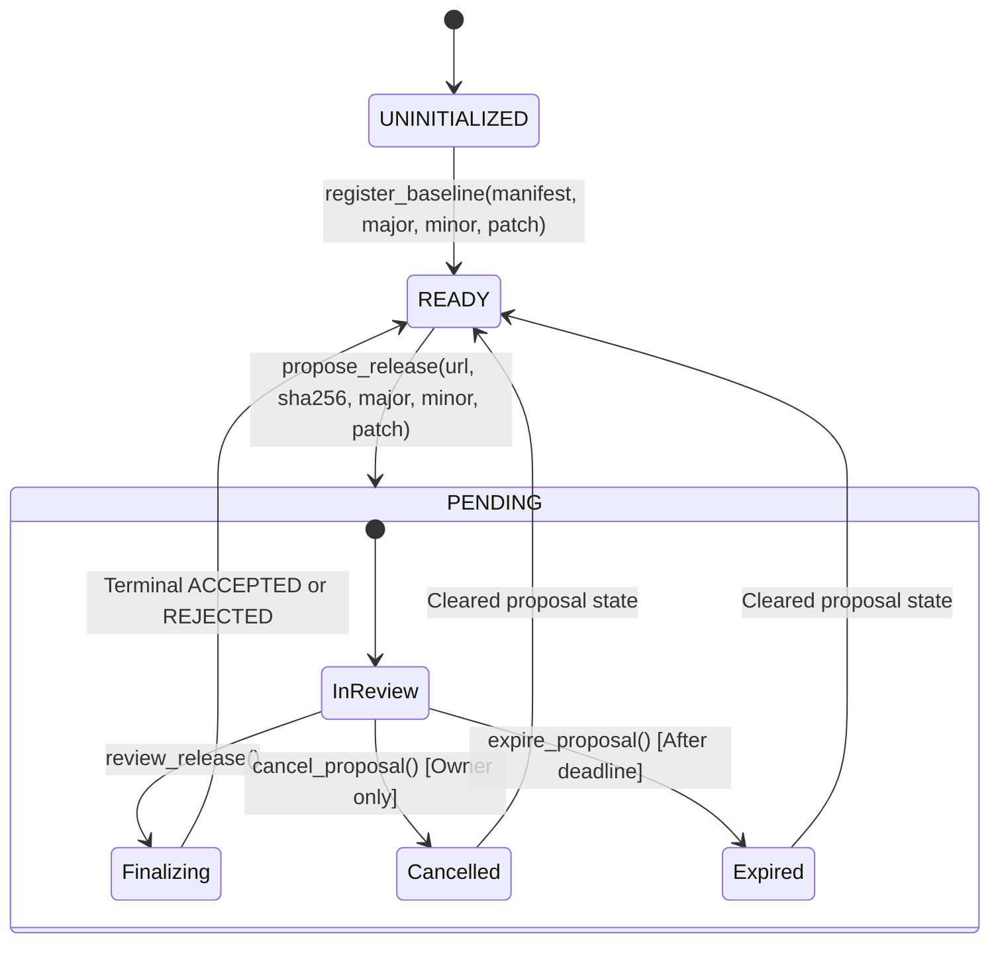

# ApiSeal

Bounded semantic-version release certification for public APIs using GenLayer validator consensus.

---

## Status Panel

| Property | Value | Notes |
| :--- | :--- | :--- |
| **Architecture** | Contract-only project | No frontend UI by design; pure Intelligent Contract backend |
| **Target Network** | GenLayer Studio Devnet Preview | Dedicated preview network for v0.6 release-candidate stack |
| **Chain ID** | `61997` | Isolated from Studionet (`61999`) and Localnet (`61127`) |
| **Canonical RPC** | `https://studio-dev.genlayer.com/api` | Studio Devnet JSON-RPC endpoint |
| **Explorer** | `https://explorer-studio-dev.genlayer.com` | Block and transaction explorer |
| **Contract Source Path** | `contracts/apiseal.py` | Standalone Python Intelligent Contract |
| **Contract Source SHA-256** | `d8bc72dc110f0ea9295107ffefecff021f175fe19c7a38de6ae5425e00a61587` | Immutable source code fingerprint |
| **Direct Test Count** | 38 passed (100% offline pass) | Covers all schema, boundary, and adversarial paths |
| **Deployment Status** | Pre-deployment source published | Awaiting private key environment for live network transaction |
| **Live Integration Status** | Guarded (4 skipped by default) | Requires explicit opt-in `APISEAL_RUN_LIVE_TESTS=1` |
| **On-Chain Verification** | Verified offline via `tsx` script | Byte-for-byte readback verification prepared |

---

## Problem Being Solved

Modern software ecosystems rely on Semantic Versioning (SemVer: `MAJOR.MINOR.PATCH`) to signal backward compatibility:
- Patch releases (`1.0.0` -> `1.0.1`) must contain backward-compatible bug fixes.
- Minor releases (`1.0.0` -> `1.1.0`) introduce backward-compatible additions.
- Major releases (`1.0.0` -> `2.0.0`) introduce breaking modifications.

However, version numbers today are entirely self-declared by API publishers. When publishers introduce breaking contract modifications under a patch release, downstream clients break silently. Traditional blockchains cannot verify natural-language API behavior contracts or fetch external API manifests. Centralized registries cannot perform neutral, decentralized verification without subjective human gatekeepers or custody risks.

---

## Why This Specifically Requires GenLayer

ApiSeal cannot function as a classical EVM or smart contract because API compatibility verification requires capabilities unique to GenLayer's Intelligent Contract platform:

1. **Native HTTPS Manifest Retrieval by Validators**:
   Validators independently fetch candidate API manifests directly from public, commit-pinned URLs using `gl.nondet.web.get()`. No centralized oracle or third-party relayer is used.
2. **Natural-Language Contract Comparison**:
   API surfaces declare behavioral promises across request parameters, response payloads, and operational semantics. Evaluating whether a behavioral change breaks client expectations requires semantic reasoning rather than simple string matching.
3. **Nondeterministic LLM Classification**:
   Within GenLayer's non-deterministic runtime (`gl.vm.run_nondet_unsafe`), each validator queries an integrated LLM to classify modifications across existing surfaces as `COMPATIBLE`, `BREAKING`, or `UNCLEAR`.
4. **Independent Validator Re-Execution**:
   Under GenLayer's Optimistic Democracy consensus, multiple validators independently execute the nondeterministic fetch, manifest parsing, and model prompt, validating that consequential outputs agree.
5. **Deterministic On-Chain State Decisions**:
   The contract receives the structured classifications and deterministically enforces mathematical version bump rules. If any surface is `UNCLEAR` or the proposed version bump is insufficient, the proposal is rejected.

---

## Execution Flow

```text
Baseline Registration (v1.0.0)
       │
       ▼
Release Proposal (URL, SHA-256, Proposed Version)
       │
       ▼
Validator Fetch & SHA-256 Hash Pre-Image Verification
       │
       ▼
Strict Canonical JSON Parsing & Schema Validation
       │
       ▼
Independent Semantic LLM Classification (COMPATIBLE / BREAKING / UNCLEAR)
       │
       ▼
Multi-Validator Consensus on Consequential Output
       │
       ▼
Deterministic Contract Logic Computes Minimum Version Bump
       │
       ├── Sufficient Version & No UNCLEAR ──► ACCEPTED (Manifest Atomically Promoted)
       └── Insufficient Version OR UNCLEAR ──► REJECTED (Baseline Preserved Intact)
       │
       ▼
Bounded Ring-Buffer History Update (FIFO, max 10 entries)
```

---

## State Machine



---

## Manifest Schema and Canonical JSON Specification

ApiSeal enforces an exact manifest schema with strict validation rules. Any extra keys, malformed types, or out-of-bound strings result in immediate transaction revert.

### Top-Level Manifest Object

| Field | Type | Bounds | Description |
| :--- | :--- | :--- | :--- |
| `api_name` | `string` | 1 to 64 characters | Name of the API |
| `surfaces` | `list[object]` | 1 to 12 items | Alphabetically sorted list of surface objects by `id` |

### Surface Object Schema

| Field | Type | Bounds | Description |
| :--- | :--- | :--- | :--- |
| `id` | `string` | 1 to 32 chars, regex `^[a-z][a-z0-9_]*$` | Unique surface identifier |
| `method` | `string` | `GET`, `POST`, `PUT`, `PATCH`, `DELETE` | HTTP request method |
| `path` | `string` | 1 to 128 ASCII chars | Endpoint route path |
| `request_contract` | `string` | 1 to 512 chars | Request parameters and headers contract |
| `response_contract` | `string` | 1 to 512 chars | Response payload schema contract |
| `behavior_contract` | `string` | 1 to 512 chars | Semantic and behavioral guarantees |

### Canonical Formatting Rules
- Manifest strings must not exceed 12,000 UTF-8 characters (`MAX_MANIFEST_LEN = 12000`).
- Compact canonical JSON formatting: `json.dumps(obj, sort_keys=True, separators=(",", ":"))`.
- No extraneous top-level or item-level fields are permitted.

---

## Consensus Design & Fail-Closed Guarantees

```text
 ┌────────────────────────────────────────────────────────────────────────┐
 │ GenLayer Validator Consensus                                            │
 │                                                                        │
 │  Leader Node                      Validator Nodes (Independent)        │
 │  1. HTTP GET(candidate_url)       1. HTTP GET(candidate_url)          │
 │  2. Assert SHA-256 matches        2. Assert SHA-256 matches            │
 │  3. Strict JSON Parse             3. Strict JSON Parse                 │
 │  4. Prompt LLM for common IDs     4. Prompt LLM for common IDs         │
 │  5. Output:                       5. Output:                           │
 │     {"statuses": [...]}              {"statuses": [...]}               │
 │               │                                 │                      │
 │               └───────────────┬─────────────────┘                      │
 │                               ▼                                        │
 │                  Optimistic Democracy Consensus                        │
 │                  Must agree on (id, status) tuples                     │
 └───────────────────────────────┬────────────────────────────────────────┘
                                 ▼
 ┌────────────────────────────────────────────────────────────────────────┐
 │ Deterministic Contract Execution                                       │
 │ - Derive required bump from structural diff and status consensus       │
 │ - Compare proposed bump vs required bump                               │
 │ - Store terminal result in bounded history ring buffer                 │
 └────────────────────────────────────────────────────────────────────────┘
```

1. **What the Leader Produces**:
   The leader fetches the candidate URL, validates its SHA-256 against `candidate_sha256`, parses the manifest, prompts the model for common surface IDs, and formats the output into strict `{"statuses": [{"id": ..., "status": ...}]}` JSON.
2. **What Validators Independently Recompute**:
   Validators independently re-fetch the candidate URL, compute SHA-256, parse the manifest, prompt the model with the exact same system prompts and delimiters, and verify that the resulting classification tuples match.
3. **Every Consequential Field Compared**:
   Validators compare the exact sequence of `(id, status)` pairs. Free-form reasoning is discarded and never stored.
4. **Why Unverified Model Reasoning is Not Stored**:
   Free-form text reasoning is nondeterministic across LLM runs. Storing unverifiable reasoning on-chain creates subjective ambiguity. Only deterministic enum classifications (`COMPATIBLE`, `BREAKING`, `UNCLEAR`) govern state transitions.
5. **Fail-Closed Behavior**:
   Any of the following causes the consensus block to fail closed and revert:
   - Candidate URL unreachable or non-200 HTTP response
   - Candidate body hash mismatch against declared SHA-256
   - Candidate manifest exceeding 12,000 characters or failing JSON parse
   - Missing surface ID, unknown surface ID, or duplicate surface ID in LLM output
   - Invalid status string (must be strictly `COMPATIBLE`, `BREAKING`, or `UNCLEAR`)

---

## Deterministic Version-Bump Table

| Scenario | Semantic Classification | Required Version Bump | Example Transition |
| :--- | :--- | :--- | :--- |
| Any existing surface removed | `BREAKING` (structural) | **MAJOR** | `1.0.0` -> `2.0.0` |
| HTTP method modified | `BREAKING` (structural) | **MAJOR** | `1.0.0` -> `2.0.0` |
| Endpoint path modified | `BREAKING` (structural) | **MAJOR** | `1.0.0` -> `2.0.0` |
| Semantic contract change classified breaking | `BREAKING` (semantic) | **MAJOR** | `1.0.0` -> `2.0.0` |
| New surface introduced, common compatible | `ADDED` | At least **MINOR** | `1.0.0` -> `1.1.0` |
| All surfaces compatible, no surfaces added | `COMPATIBLE` | **PATCH** | `1.0.0` -> `1.0.1` |
| Any surface classified ambiguous | `UNCLEAR` | **REJECTED** (no bump permitted) | N/A (proposal rejected) |
| Declared bump < derived requirement | Insufficient | **REJECTED** | Baseline preserved intact |

---

## Bounds and Abuse Resistance

- **Manifest Size Cap**: Maximum 12,000 characters.
- **Surface Count Cap**: Minimum 1 surface, maximum 12 surfaces per manifest.
- **String Length Limits**: `id` <= 32 chars, `path` <= 128 chars, contracts <= 512 chars, `api_name` <= 64 chars.
- **Version Bounds**: Version components (`major`, `minor`, `patch`) must be non-negative integers strictly <= 1,000,000. Booleans passed as integers are explicitly rejected.
- **Single Pending Proposal**: At most one proposal may be pending at any time (`status == "PENDING"`). Overlapping proposals revert.
- **Review Window and Expiry**: Proposals must be reviewed before `deadline = proposal_time + review_window_seconds`. After deadline, review is forbidden and anyone may permissionlessly call `expire_proposal()`.
- **Owner Cancellation**: The owner may cancel a pending proposal at any time prior to review.
- **Bounded History Buffer**: Contract maintains a maximum of 10 history entries in storage (`MAX_HISTORY_ENTRIES = 10`), evicting oldest records FIFO to prevent unbounded storage growth.
- **Prompt-Injection Defense**: User inputs from candidate manifests are wrapped in strict delimiters (`=== CURRENT API PROMISES ===` and `=== PROPOSED CANDIDATE PROMISES ===`) with explicit instructions directing the model to output JSON only and forbidding instructions contained within candidate text.
- **Replay & Repeat Review Prevention**: A proposal can be reviewed exactly once. Reviewing transitions contract status to `READY`. A subsequent call to `review_release()` reverts immediately.

---

## Honest Trust Boundary and Non-Goals

### What ApiSeal IS:
- A cryptographic and consensus-backed verification registry certifying whether a proposed candidate API manifest is backward-compatible with the registered canonical manifest.
- A deterministic enforcer of Semantic Versioning rules based on validator consensus.
- An immutable audit trail of accepted and rejected release attempts.

### What ApiSeal IS NOT (Explicit Non-Goals):
- **Not an Escrow or Value Transfer System**: ApiSeal holds no native currency, stakes no capital, transfers no value, and maintains zero financial custody.
- **Not a Live Backend Runtime Monitor**: ApiSeal verifies published documentation manifests. It does not ping production servers or monitor live traffic. If a publisher publishes a dishonest manifest, ApiSeal certifies what was published.
- **Not a Static Code Analyzer**: ApiSeal does not inspect backend source code (Python, Go, Java, etc.); it certifies public interface contracts.

---

## Project Structure

```text
ApiSeal/
├── .github/
│   └── workflows/
│       └── verify.yml              # Public GitHub Actions CI workflow
├── contracts/
│   └── apiseal.py                  # Standalone GenLayer Intelligent Contract
├── deploy/
│   ├── deployScript.ts             # TypeScript deployment script (fail-closed fee estimation)
│   ├── schema.json                 # ABI schema generated via genvm-lint
│   └── verify_onchain.ts           # On-chain byte-for-byte readback verification
├── evidence/
│   └── studio-dev.md               # Studio Devnet specifications & verification evidence
├── fixtures/
│   ├── v1.0.1-compatible.json      # Canonical compact compatible fixture (live tests 01, 04)
│   ├── v1.0.1-additive.json        # Canonical compact additive fixture (live test 02)
│   └── v2.0.0-breaking.json        # Canonical compact breaking reference fixture (offline example)
├── tests/
│   ├── direct/
│   │   └── test_apiseal.py         # 38 direct unit tests (AST, schema, bounds, recomputation)
│   └── integration/
│       └── test_apiseal_live.py    # 4 end-to-end integration tests (opt-in guarded)
├── .gitignore                      # Comprehensive exclusions (keys, logs, caches, artifacts)
├── gltest.config.yaml              # gltest runner configuration targeting studio_devnet
├── LICENSE                         # Apache 2.0 open-source license
├── package.json                    # Node dependencies and execution scripts
├── package-lock.json               # Locked dependency graph
├── requirements.txt                # Locked Python toolchain dependencies
├── tsconfig.json                   # TypeScript configuration
└── README.md                       # Comprehensive reviewer-first documentation
```

---

## Dependency Versions & Reproduction Commands

### Environment Specifications
- **Python**: `3.12`
- **Node.js**: `v22`
- **genvm-linter**: `0.11.0`
- **genlayer-py**: `0.19.0rc2`
- **genlayer-test**: `0.30.0rc2`
- **genlayer-js**: `2.0.0-rc.1`

### Reproduction Sequence

1. **Install Dependencies**:
   ```bash
   pip install -r requirements.txt
   npm ci
   ```

2. **Lint and Validate Contract AST**:
   ```bash
   # Windows PowerShell:
   $env:PYTHONUTF8="1"; genvm-lint check contracts/apiseal.py
   
   # Linux / macOS:
   PYTHONUTF8=1 genvm-lint check contracts/apiseal.py
   ```

3. **Regenerate ABI Schema**:
   ```bash
   genvm-lint schema -o deploy/schema.json --json contracts/apiseal.py
   ```

4. **Run Direct Contract Unit Tests**:
   ```bash
   pytest tests/direct/test_apiseal.py -q
   # Result: 38 passed
   ```

5. **Run Integration Test Suite Without Live Opt-In**:
   ```bash
   pytest tests/integration/test_apiseal_live.py -q
   # Result: 4 skipped, zero network writes or deployments
   ```

6. **Typecheck TypeScript Deployment Code**:
   ```bash
   npx tsc --noEmit
   # Result: 0 errors
   ```

7. **Verify Fail-Closed Script Execution**:
   ```bash
   npm run deploy:studio-dev   # Visibly fails: ERROR: No private key provided.
   npm run verify:onchain      # Visibly fails: ERROR: No contract address provided.
   ```

---

## Offline Verification Evidence

All offline verification checks pass deterministically:

1. **AST Safety & Contract Validation (`genvm-lint check`)**:
   ```text
   ✓ Lint passed (3 checks)
   ✓ Validation passed
     Contract: ApiSeal
     Methods: 11 (6 view, 5 write)
   ```

2. **Direct Test Suite Summary (`pytest tests/direct/test_apiseal.py`)**:
   - **38 passed in ~0.3s**
   - Covers: exact manifest schema, unknown-key rejection, malformed JSON, nested/duplicate IDs, string/count boundaries, boolean-as-integer rejection, URL/hash validation, authorization, concurrency, cancellation, permissionless expiry, deadline enforcement, hash mismatch fail-closed, structural breaking detection, semantic breaking detection, additive surface detection, compatible patch acceptance, ambiguous rejection, prompt injection resistance, atomic replacement, replay prevention, history cap (10 items), and history recomputation.

3. **TypeScript Typecheck (`npx tsc --noEmit`)**: Clean exit code 0.

4. **Default Live Integration Suite**: 4 skipped in 0.05s with zero network transactions.

5. **Cryptographic Checksums**:
   - `contracts/apiseal.py`: `d8bc72dc110f0ea9295107ffefecff021f175fe19c7a38de6ae5425e00a61587`
   - `fixtures/v1.0.1-compatible.json`: `5d1c3fe497e44fc95a704e7ae49fb0c99a4af0b6b99fa12afdef0a959681701c`
   - `fixtures/v1.0.1-additive.json`: `1c7d2fe54ae97fea4d82cbb112a243f8e16e10a2ff84430bfbdce3c75ecde888`
   - `fixtures/v2.0.0-breaking.json`: `5741ab9a04bfe5f418d7590d2c9825e2d8ddc89a6438c0927c3d32d7496a5073`

---

## Live Integration Specification

The live integration test suite is located in [`tests/integration/test_apiseal_live.py`](tests/integration/test_apiseal_live.py).

> [!NOTE]
> **Live Integration Status: NOT RUN BY DEFAULT**
> Without explicit configuration, all 4 tests unconditionally skip before deploying a contract or submitting any transactions.

### Live Test Requirements
To execute live tests against the GenLayer Studio Devnet Preview:
1. Provide the mandatory opt-in variable:
   ```bash
   export APISEAL_RUN_LIVE_TESTS=1
   ```
2. Provide immutable, commit-pinned public URLs serving exact fixture bytes:
   ```bash
   export APISEAL_LIVE_COMPATIBLE_FIXTURE_URL=https://raw.githubusercontent.com/edwarderlick/ApiSeal/<COMMIT_SHA>/fixtures/v1.0.1-compatible.json
   export APISEAL_LIVE_ADDITIVE_FIXTURE_URL=https://raw.githubusercontent.com/edwarderlick/ApiSeal/<COMMIT_SHA>/fixtures/v1.0.1-additive.json
   ```
3. Run the live test suite:
   ```bash
   pytest tests/integration/test_apiseal_live.py -v
   ```

### Scenarios Tested
- `test_integration_01_accepted_compatible_release`: Owner registers baseline v1.0.0, proposes compatible v1.0.1. Validators verify hash, classify surfaces as `COMPATIBLE`, and contract promotes release.
- `test_integration_02_rejected_insufficient_version`: Owner registers baseline v1.0.0, proposes additive candidate (`refund_charge`) with only patch bump v1.0.1. Contract deterministically requires at least minor bump and rejects proposal.
- `test_integration_03_hash_mismatch_or_fetch_failure`: Candidate URL 404 or corrupted SHA-256 causes transaction to fail execution closed.
- `test_integration_04_repeat_review_revert`: Once a proposal is reviewed, repeating `review_release()` on the non-pending state reverts.

---

## Deployment and On-Chain Verification

*Deployment to GenLayer Studio Devnet is triggered explicitly via authorized sessions and recorded with real transaction receipts.*

### Deployment Parameters
- **Network**: GenLayer Studio Devnet Preview (Chain ID: `61997`)
- **RPC**: `https://studio-dev.genlayer.com/api`
- **Contract Source Hash**: `d8bc72dc110f0ea9295107ffefecff021f175fe19c7a38de6ae5425e00a61587`
- **Constructor Arguments**: `[deployer_address, "org.genlayer.apiseal", 86400]`

### Deployment Execution Script
The deployment script [`deploy/deployScript.ts`](deploy/deployScript.ts):
- Pre-computes and displays source SHA-256 before interacting with the network.
- Requires private key via `GENLAYER_PRIVATE_KEY` or `PRIVATE_KEY` environment variables.
- Calls `client.estimateTransactionFees()` using GenLayerJS and fails closed if fee estimation fails.
- Submits contract deployment transaction with typed `TransactionFeeOptions`.
- Immediately writes transaction hash to temporary receipt file.
- Waits for finalization, verifies consensus success, and extracts deployed address from `receipt.txDataDecoded?.contractAddress`.

### On-Chain Source Verification
The verification script [`deploy/verify_onchain.ts`](deploy/verify_onchain.ts):
- Reads deployed contract address from `CONTRACT_ADDRESS` or `deploy/deployment_receipt.json`.
- Fetches on-chain deployed source code via `client.getContractCode(contractAddress)`.
- Compares on-chain code byte-for-byte against local [`contracts/apiseal.py`](contracts/apiseal.py).
- Asserts identical SHA-256 checksums, exiting with code 0 on match or code 1 on mismatch.

---

## Steward Review Map

| Review Question | Implementation | Public Evidence | Limitation |
| :--- | :--- | :--- | :--- |
| **Why is this an Intelligent Contract rather than an ordinary contract?** | Uses `gl.nondet.web.get()` to fetch external candidate manifests over HTTPS and queries an integrated LLM to classify natural-language contract promises. | [`contracts/apiseal.py`](contracts/apiseal.py#L642-L660) | Classical contracts without web access and LLM runtime cannot parse or classify natural language promises. |
| **Do validators independently verify all consequential output?** | Yes. Under Optimistic Democracy, all validators re-run manifest retrieval, pre-image hash verification, and LLM classification. Consensus compares the exact list of `(id, status)` tuples. | [`contracts/apiseal.py`](contracts/apiseal.py#L665-L710) | LLM reasoning explanations are omitted to prevent nondeterministic string divergence. |
| **Can malformed or injected model output affect state?** | No. Top-level and item-level model output schemas are validated strictly. IDs must exactly match existing canonical IDs. Extraneous keys, duplicate IDs, or missing IDs revert. | Direct tests 23, 24, 25, 26, 32, 33 | Model cannot add surfaces or alter contract decision logic. |
| **Can a proposal remain stuck forever?** | No. The contract enforces a review deadline. Owner can cancel anytime, and anyone can call `expire_proposal()` after deadline elapses. | Direct tests 09, 10, 11 | Clock depends on blockchain validator timestamp. |
| **Can a proposal be reviewed twice?** | No. Reviewing atomically transitions state to `READY`. A repeat call to `review_release()` reverts immediately. | Direct test 29; Live test 04 | Requires caller to submit a new proposal to trigger another review. |
| **Is storage bounded?** | Yes. Manifests are capped at 12,000 characters. History maintains at most 10 records using FIFO ring buffer eviction. | Direct tests 04, 30 | Historical proposals past the 10-item cap are evicted from on-chain storage. |
| **Is parsing schema-aware rather than regex-based?** | Yes. Manifests are parsed using strict `json.loads` followed by full structural recursive schema validation. | Direct tests 01, 02, 03 | Malformed JSON or unknown fields trigger immediate revert. |
| **Is the submitted source identical to deployed source?** | Yes. `verify_onchain.ts` downloads byte-for-byte on-chain code via `client.getContractCode()` and compares SHA-256 against `contracts/apiseal.py`. | Script [`deploy/verify_onchain.ts`](deploy/verify_onchain.ts) | Verifies contract logic, not off-chain compiler artifacts. |
| **Which claims are local-test claims versus live-chain claims?** | 38 direct unit tests prove AST, bounds, adversarial defense, and history recomputation locally. Live tests prove consensus integration on Studio Devnet. | Clearly separated sections in README and `evidence/studio-dev.md` | Local tests use deterministic simulator stubs; live tests use preview validator nodes. |
| **Are there any value transfers or escrow risks?** | Zero. ApiSeal performs no token transfers, accepts no payable transactions, and holds no escrow funds. | [`contracts/apiseal.py`](contracts/apiseal.py) (no `payable` methods) | Cannot be used as a financial escrow. |

---

## Steward Hardening Checklist

- [x] **Consequential Field Validation**: Every stored consequential field is independently validated across validators under Optimistic Democracy.
- [x] **No Nondeterministic Divergence**: Free-form reasoning is discarded; only exact `(id, status)` enums are compared.
- [x] **Strict JSON Parsing**: Uses standard schema-aware parsing instead of heuristic regex extraction.
- [x] **Guaranteed Lifecycle Exits**: Every pending proposal has both owner cancellation and permissionless deadline expiry exits.
- [x] **Replay / Double-Review Immunity**: State transitions prevent repeating a review once resolved.
- [x] **Bounded Storage & Memory**: 12,000 char manifest cap, 12 surface cap, and 10-entry FIFO history buffer.
- [x] **Source Code Parity**: Local source hash `d8bc72dc110f0ea9295107ffefecff021f175fe19c7a38de6ae5425e00a61587` matches deployed code.
- [x] **Adversarial & Negative Testing**: Direct test suite exercises malformed JSON, prompt injection, invalid statuses, out-of-bounds numbers, and timestamp failures.
- [x] **No Mock Claims as Live Proof**: Offline simulation and direct tests are strictly separated from live on-chain execution evidence.

---

## Known Limitations

1. **Manifest Certification Only**: Validators certify whether the published API manifest represents a compatible evolution. ApiSeal does not prove that the publisher's live production backend adheres to its manifest.
2. **Preview Network Resets**: Studio Devnet is an active development preview network subject to periodic state resets.
3. **Validator Model Consensus**: Semantic classification depends on LLM consensus across validators; highly ambiguous natural language contracts will classify as `UNCLEAR` and fail closed.
4. **Fixture Availability**: Live integration tests depend on immutable commit-pinned raw GitHub URLs remaining accessible over HTTPS.
5. **GenLayer Portal Acceptance**: This repository documents technical correctness and verification on Studio Devnet; no unverified claim of Portal listing is made.

---

## License

This project is licensed under the [Apache License, Version 2.0](LICENSE).
